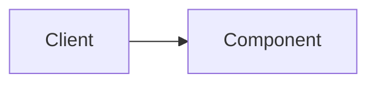

# Route: <NNN short name>

Navigator | Drafted: <date> | Approved by: <captain or pending>

## Approach
<The design in plain language.>

## Components
| Component | New / Changed | Path | Serves (R#) |
|---|---|---|---|

## Interfaces and contracts
<Exact shapes: routes, request and response fields, events, schemas.>

## Data changes
- Migrations:
- Backfills:
- Rollback plan:

## Platform changes
<Config, infrastructure, pipelines, secrets (names only).>

## Testing strategy
| Acceptance check | Test type | Test location |
|---|---|---|

## Risks
| Risk | Likelihood | Impact | Mitigation |
|---|---|---|---|

## Alternatives considered
1. <Alternative>: <why it lost>

## Exceptions
<Any deviation from the ops manual. Each needs CAPTAIN APPROVAL REQUIRED.>
